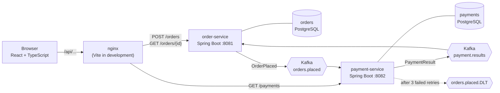
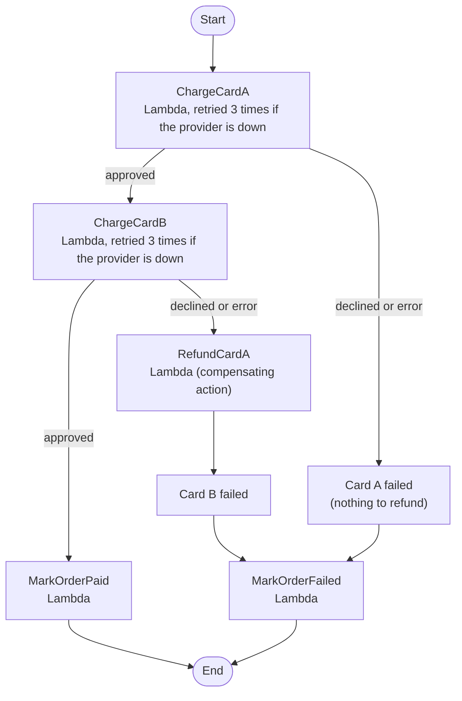
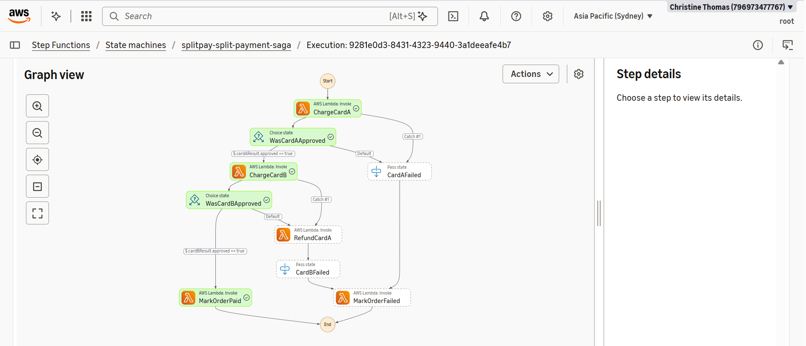
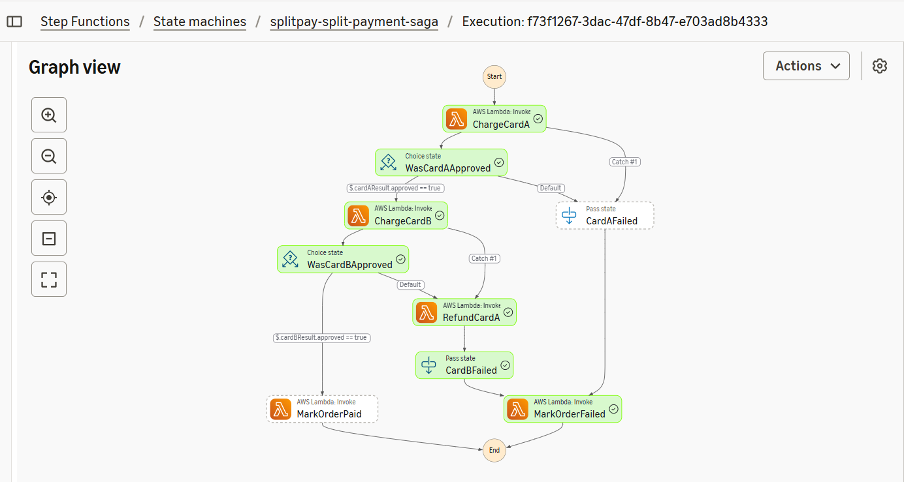

# Split-Payment Checkout

[](https://github.com/tinathomas123/split-payment-checkout/actions/workflows/ci.yml)

A customer pays for one order with **two cards**. The project shows how to keep a payment that spans several steps consistent when one of them fails: if card B is declined after card A has been charged, card A is refunded automatically.

It is built twice, in two styles:

1. **Event-driven microservices:** two Spring Boot services, each with its own PostgreSQL database, communicating through Kafka, with a React + TypeScript front end. Runs locally or in Kubernetes.
2. **Serverless orchestration:** the same split-payment saga as an AWS Step Functions state machine calling Node.js (TypeScript) Lambdas, created and destroyed with Terraform.

**Tech:** Java 21, Spring Boot, Spring Kafka, PostgreSQL, Apache Kafka (KRaft), React, TypeScript, Vite, Docker, Kubernetes, nginx, AWS Step Functions, AWS Lambda (Node.js), Terraform, GitHub Actions.

## Architecture

### Microservices (Kafka)



1. `POST /orders` saves the order as `PENDING_PAYMENT` and, once the transaction commits, publishes **OrderPlaced**.
2. payment-service charges card A, then card B (simulated provider):
   - both approved: publishes **COMPLETED**;
   - card B declined: refunds card A (compensating action) and publishes **FAILED**;
   - card A declined: card B is never charged; publishes **FAILED**.
3. order-service consumes the result and sets the order to `PAID` or `PAYMENT_FAILED`.
4. The front end's order page checks the status every 2 seconds until it changes.

### Serverless saga (AWS Step Functions)



Screenshots of real executions (the AWS resources were destroyed afterwards):

| Success path | Refund path |
|---|---|
|  |  |

## Test cards

Only the last 4 digits are used, and payments are simulated.

| Last 4 digits | Result |
|---|---|
| `0002` | Declined (a business outcome: not retried) |
| `9999` | Payment provider down (a technical error: retried) |
| anything else | Approved |

## Run locally

Needs Docker Desktop, Java 21, Maven and Node.js.

1. Start PostgreSQL and Kafka: `docker compose up -d`
2. Start each service in its own terminal: `mvn spring-boot:run` in `order-service` and in `payment-service`.
3. Start the front end:
   ```
   cd frontend
   npm install
   npm run dev
   ```
4. Open http://localhost:5173, add items to the cart, and check out with two cards.

The Vite dev server forwards `/api/orders` to port 8081 and `/api/payments` to port 8082, so the services need no CORS settings.

**Without the front end:**

```
curl -X POST http://localhost:8081/orders -H "Content-Type: application/json" -d @requests/order-success.json
curl http://localhost:8081/orders/1
curl "http://localhost:8082/payments?orderId=1"
```

Other cases are in `requests/`: `order-card-b-declined.json` (refund), `order-provider-down.json` (retries, then the dead-letter topic) and `order-bad-split.json` (`400 Bad Request`).

See what's in the dead-letter topic:

```
docker compose exec kafka /opt/kafka/bin/kafka-console-consumer.sh --bootstrap-server localhost:9092 --topic orders.placed.DLT --from-beginning
```

## Run in Kubernetes

Give Docker Desktop at least 6 GB of memory. Build the images from the project folder:

```
docker build -t splitpay/order-service:local order-service
docker build -t splitpay/payment-service:local payment-service
docker build -t splitpay/frontend:local frontend
```

**Option A: Docker Desktop's Kubernetes** (Settings → Kubernetes → Enable, cluster type kubeadm):

```
kubectl config use-context docker-desktop
kubectl apply -f k8s/
kubectl get pods -n splitpay -w
```

Open http://localhost:30080.

**Option B: kind**

```
kind create cluster --name splitpay --config kind-config.yaml
kind load docker-image splitpay/order-service:local splitpay/payment-service:local splitpay/frontend:local --name splitpay
kubectl apply -f k8s/
```

Open http://localhost:8080 (`kind-config.yaml` maps it to the front end's NodePort).

The services may restart once or twice at first while PostgreSQL and Kafka start; Kubernetes restarts them until they connect.

| File | What it creates |
|---|---|
| `k8s/01-config.yaml` | ConfigMap (Kafka and database addresses) and Secret (database credentials) |
| `k8s/10-databases.yaml` | A Deployment and Service for each PostgreSQL database |
| `k8s/11-kafka.yaml` | Single-node Kafka (KRaft) |
| `k8s/20-…`, `k8s/21-…` | A Deployment and Service for each Spring Boot service |
| `k8s/30-frontend.yaml` | nginx serving the React app and forwarding `/api/...` to the services (NodePort 30080) |

Remove everything with `kubectl delete namespace splitpay`.

## Run the Step Functions saga on AWS

Needs an AWS account, the AWS CLI (configured with `aws configure`) and Terraform. **Set up an AWS budget alert first.** The resources cost almost nothing for a few test runs, and `terraform destroy` removes them.

```
cd aws/lambdas
npm install
npm test
cd ../terraform
terraform init
terraform apply
```

Start an execution (copy the ARN from Terraform's `state_machine_arn` output), from the `aws/terraform` folder:

```
aws stepfunctions start-execution --state-machine-arn <state_machine_arn> --input file://../test-inputs/success.json
aws stepfunctions start-execution --state-machine-arn <state_machine_arn> --input file://../test-inputs/card-b-declined.json
```

Also in `aws/test-inputs/`: `card-a-declined.json` and `card-b-provider-down.json` (three retries, then card A is refunded). Watch each run in the AWS console under Step Functions → State machines → `splitpay-split-payment-saga`.

When finished: `terraform destroy`

## Continuous integration

GitHub Actions (`.github/workflows/ci.yml`) runs on every push:

- Java unit tests for both services (JUnit 5, Mockito);
- Lambda unit tests (Node.js test runner);
- front-end type check and production build;
- `terraform fmt` and `terraform validate`;
- Docker builds of the three images, once the tests pass.

## Design notes

- **Publish after commit:** OrderPlaced is sent only after the order's transaction commits, so no event is sent for an order that was rolled back. A crash between the commit and the send could still lose the event; the **transactional outbox pattern** would close that gap.
- **Idempotent consumers:** Kafka can deliver a message more than once, so payment-service never processes the same order twice and order-service ignores repeated results.
- **Business outcome versus technical error:** a declined card is a normal result and is not retried; the provider being down is an exception, retried 3 times and then sent to a dead-letter topic (Kafka) or caught and compensated (Step Functions).
- **Saga with a compensating action:** there is no single transaction across two card charges, so a failed second charge is undone by refunding the first.
- **Choreography versus orchestration:** the Kafka version is choreographed (each service reacts to events); the Step Functions version is orchestrated (one state machine controls every step and shows its history visually).
- **Money:** `BigDecimal` compared with `compareTo` in Java; whole cents in the front end, so splitting a total never produces rounding errors.
- **Card data:** only the last 4 digits are ever sent or stored.
- **Configuration:** the same image runs everywhere; database and Kafka addresses come from environment variables (a ConfigMap and Secret in Kubernetes).
- **Least privilege:** the Step Functions role can invoke only the three saga Lambdas; the Lambdas can only write logs.
- **Not production-ready, by design:** `ddl-auto: update` instead of migrations (Flyway), databases on `emptyDir` instead of persistent volumes, simulated payment provider, no authentication.

## What I learned

<!-- Rewrite this section in your own words before publishing. -->

- How to keep a multi-step payment consistent without a distributed transaction, and the trade-offs between choreography (Kafka events) and orchestration (Step Functions).
- Why the place an event is published from matters (after commit, and what the outbox pattern adds).
- How Kubernetes Deployments, Services, ConfigMaps and Secrets fit together, and how services find each other by name inside a cluster.
- Defining cloud infrastructure as code with Terraform, including IAM roles scoped to exactly what each service needs.
